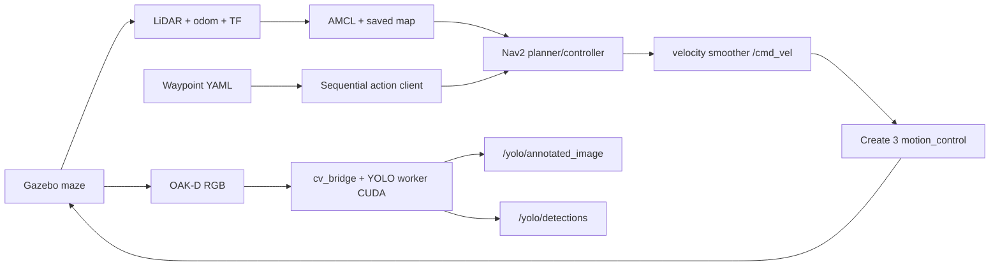

# Bài thực hành 05 — TurtleBot 4, AMCL, Nav2 tuần tự và YOLO RGB

Package Python `turtlebot4_lab05` tái sử dụng simulator/bridge/controller và bản đồ
thật của bài 04. World là **maze**, model **standard**, Ignition Gazebo Fortress,
ROS 2 Humble. Node `sequential_navigation` gửi action `/navigate_to_pose` lần lượt,
chỉ chuyển goal khi status SUCCEEDED=4. Node `yolo_node` nhận camera RGB thật, chạy
YOLO11n trên RTX 3060 và xuất bbox/class/confidence. YOLO không phát vận tốc,
không gửi goal và không thay chức năng tránh vật cản của Nav2.

Kết quả kiểm chứng và đối chiếu đề bài: [VALIDATION.md](VALIDATION.md). Không dùng
video bên ngoài hoặc kết quả nhận diện hard-code. Link video: **CHỜ người dùng
quay/upload**. Repository: https://github.com/bangrbt/turtlebot4_lab/tree/assignments_2 .

## Cấu trúc và luồng dữ liệu

```text
turtlebot4_lab05/
├── turtlebot4_lab05/
│   ├── sequential_navigation.py  # readiness, goals, timeout/retry/cancel/dwell
│   ├── yolo_node.py              # latest-frame worker, GPU/CPU, annotated image
│   ├── configuration.py          # waypoint provenance/hash/free-space validation
│   ├── initialize_pose.py        # initial pose trước nhiệm vụ, không điều khiển
│   ├── capture_waypoints.py      # /clicked_point + yaw riêng -> YAML
│   └── spawn_objects.py          # asset 3D static có collision, không sửa tường
├── launch/{bringup,yolo}.launch.py
├── config/                      # waypoint, initial pose, YOLO, asset manifest, RViz
├── maps/{map.yaml,map.pgm}        # bản sao map thật; map gốc bài 04 giữ nguyên
├── scripts/                     # cài Python, tải tài nguyên, environment, observer
├── test/                        # cấu hình sai, hash, unknown/obstacle, quaternion
├── package.xml / setup.py / setup.cfg
└── requirements-yolo.txt
```



## Phiên bản đã kiểm tra

Ubuntu 22.04, Python 3.10.12, Humble, Fortress 6.18.0; NVIDIA RTX 3060 Laptop
6144 MiB, driver 595.99.02. PyTorch **2.5.1+cu121**, CUDA runtime **12.1**,
torchvision **0.20.1+cu121**, Ultralytics **8.3.221**, NumPy **1.26.4**,
SciPy **1.11.4**, OpenCV **4.10.0**. `cv_bridge`, `rclpy`, OpenCV, torch và
Ultralytics import trong cùng môi trường Python. Tensor và tham số model sau
inference được kiểm tra ở `cuda:0`, không chỉ dựa vào `nvidia-smi`.

Tài liệu đối chiếu:
[TB4 Navigator Humble](https://turtlebot.github.io/turtlebot4-user-manual/tutorials/turtlebot4_navigator.html),
[Nav2 Commander API](https://docs.nav2.org/commander_api/index.html),
[Ultralytics predict](https://docs.ultralytics.com/modes/predict/),
[YOLO11](https://docs.ultralytics.com/models/yolo11/),
[PyTorch 2.5.1 CUDA wheels](https://pytorch.org/get-started/previous-versions/).
Bài này dùng Action Humble trực tiếp để giới hạn thời gian chờ và hủy action.

## Cài đặt — chạy một lần

Workspace dự kiến `~/turtlebot4_lab_ws`; clone repository vào vị trí tương ứng
nếu làm trên máy khác. Giữ package bài 04 vì launch bài 05 tái sử dụng wrapper đó.

```bash
sudo apt update
sudo apt install ros-humble-turtlebot4-simulator ros-humble-turtlebot4-navigation \
  ros-humble-nav2-simple-commander ros-humble-cv-bridge ros-humble-rviz2 \
  python3-colcon-common-extensions python3-yaml python3-requests python3-pil \
  python3-opencv python3-pytest
cd ~/turtlebot4_lab_ws
source /opt/ros/humble/setup.bash
colcon build --symlink-install --packages-select turtlebot4_lab turtlebot4_lab05
source lab_env.bash
bash src/turtlebot4_lab05/scripts/setup_python.bash
source src/turtlebot4_lab05/scripts/lab05_env.bash
python src/turtlebot4_lab05/scripts/download_resources.py --cache "$TB4_LAB05_CACHE"
```

Chỉ cài dependency còn thiếu trên máy đã có ROS/simulator. Không cài lại ROS hoặc
nâng driver NVIDIA từ script. Venv `--system-site-packages` truy cập ROS bindings;
script bootstrap pip từ PyPA nếu máy thiếu ensurepip. Wheels CUDA lấy từ index
PyTorch chính thức, không cần cài CUDA toolkit toàn hệ thống để chạy inference.
Giữ NumPy <2 vì ROS Humble `cv_bridge` của môi trường này dùng ABI NumPy 1.x.
Các phiên bản Python trong `config/python-lock.txt`, weights/asset hash trong
`config/resources_manifest.json`. Tài nguyên lớn nằm trong `.cache_lab05`, ngoài Git.
Kiểm tra trước demo:

```bash
nvidia-smi
python -c "import rclpy,cv_bridge,cv2,torch,ultralytics; print(torch.__version__, torch.cuda.is_available(), torch.cuda.get_device_name(0) if torch.cuda.is_available() else 'CPU')"
```

## Chạy demo đúng thứ tự — mỗi terminal source riêng

**Đầu mỗi terminal A/B/C/D/E/F:**

```bash
cd ~/turtlebot4_lab_ws
source lab_env.bash
source src/turtlebot4_lab05/scripts/lab05_env.bash
```

`lab_env.bash` đặt ROS_DOMAIN_ID=64, ROS_LOCALHOST_ONLY=1,
IGN_PARTITION=turtlebot4_lab_64, không source workspace UR3. `lab05_env.bash` đưa
venv site-packages vào PYTHONPATH vì console script ROS có thể dùng shebang
`/usr/bin/python3`. Source theo đúng thứ tự trên; không source lại lab_env sau
lab05_env trong cùng terminal mà quên source lab05_env lần nữa.

**A — simulator** (giữ chạy):

```bash
ros2 launch turtlebot4_lab simulation.launch.py model:=standard rviz:=false
```

Dùng `maze` đã khảo sát, không dùng `turtlebot4_gz_bringup` của Jazzy. Clock phải
chạy/Play. Trước khi chạy lại cả demo, dừng phiên cũ bằng Ctrl+C ở các terminal,
rồi `ros2 run turtlebot4_lab cleanup_simulation.py --stop`; script chỉ dọn đúng
partition/domain của bài. Không mở hai simulator hoặc hai Nav2.

**B — localization/Nav2/RViz** (giữ chạy, chưa cho robot tự chạy):

```bash
ros2 launch turtlebot4_lab05 bringup.launch.py start_yolo:=false start_navigation:=false
```

Map mặc định là bản sao được cài vào share package. Có thể override
`map:=/absolute/path/map.yaml`. Không chạy SLAM trong giai đoạn này.

**C — undock, thêm vật thể, kiểm tra initial pose:**

```bash
ros2 action send_goal /undock irobot_create_msgs/action/Undock '{}' --feedback
ros2 run turtlebot4_lab05 spawn_demo_objects
```

Chỉ spawn một lần mỗi phiên simulator; tên model cố định, không tự nhân bản.
World giữ nguyên tường/nền; chỉ thêm bốn asset trong `config/objects.yaml`.
Undock có thể quay robot gần 180°, vì vậy đặt initial pose SAU undock theo hướng
thật. RViz Fixed Frame `map`: chọn **2D Pose Estimate**, click vị trí trên map và
kéo mũi tên đúng hướng robot. Kiểm tra LiDAR khớp tường. TF/lifecycle có dữ liệu
không tự chứng minh localization đúng.

Có helper tùy chọn cho **đúng map maze đã xác thực alignment** của bài này:

```bash
ros2 run turtlebot4_lab05 initialize_pose --ros-args -p use_sim_time:=true \
  -p source:=sim_ground_truth
ros2 run turtlebot4_lab check_runtime.py --stage navigation
```

Helper đối chiếu hash map, dùng ground truth mô phỏng chỉ để đặt initial pose
trước nhiệm vụ; không gửi goal/vận tốc, không cập nhật pose trong lượt demo.
Không áp dụng giả định world=map cho map khác: dùng RViz và cấu hình đã đo.
`source:=configured` đọc pose đo cũ trong initial_pose.yaml; cần đối chiếu lại sau
mỗi undock, không coi hướng đo một lần là hằng số chính xác cho mọi lần chạy.

**D — YOLO** (giữ chạy):

```bash
ros2 launch turtlebot4_lab05 yolo.launch.py device:=0 show_window:=true
```

Xem `YOLO annotated RGB` trong RViz hoặc thêm display **Image**, topic
`/yolo/annotated_image`, QoS Best Effort. `show_window:=true` bật cửa sổ OpenCV
(nhấn q/Esc để tắt preview; inference vẫn chạy). Launch mặc định bật cửa sổ
800 px; dùng `show_window:=false` để chạy headless. Không có DISPLAY cũng tự
chuyển headless. RViz và camera có thể đặt cạnh nhau để theo dõi lúc robot chạy.
Kiểm tra camera và CUDA:

```bash
ros2 topic info /oakd/rgb/preview/image_raw --verbose
ros2 topic info /oakd/rgb/preview/camera_info --verbose
ros2 topic echo /yolo/status --once --qos-durability transient_local
ros2 topic echo /yolo/detections --once
```

`state=ready`, `actual_model_device=cuda:0` mới là bằng chứng model đã inference
trên GPU. `/yolo/annotated_image` giữ nguyên header/stamp/frame từ ảnh RGB vào.
Không có vật thể thì vẫn publish ảnh và `detections: []`, không tạo nhãn giả.

**E — ghi bằng chứng tùy chọn** (chạy trước node mission):

```bash
python src/turtlebot4_lab05/scripts/record_demo.py \
  --output-directory "$TB4_LAB_WS/log/lab05_demo"
```

Observer chỉ subscribe; lưu ảnh annotated thật theo header, kiểm tra CUDA,
inference khi robot chuyển động, action status qua node mission, pose và hazard.
Không dùng observer để lái robot. Log/video/raw trace không đưa vào Git.

**F — bắt đầu mission bằng code** (chỉ sau khi đã kiểm tra localization):

```bash
ros2 run turtlebot4_lab05 sequential_navigation --ros-args \
  --params-file src/turtlebot4_lab05/config/navigation.yaml \
  -p localization_confirmed:=true \
  -p log_file:="$TB4_LAB_WS/log/lab05_navigation.jsonl"
```

Node tự đọc YAML và gửi Goal_1 → Goal_2 → Goal_3, mỗi goal SUCCEEDED mới chuyển
tiếp; dừng 8 giây ở mỗi đích cho YOLO. Không click Nav2 Goal hoặc teleop thay
node. Không có publisher vận tốc từ package bài 05. Chỉ Nav2 → motion_control
điều khiển robot. Đóng/tắt mọi teleop trước khi chạy; node cũng kiểm tra điều này.

## Waypoint có nguồn đo và cách chọn điểm mới

`config/waypoints.yaml` chứa ba vùng khác nhau, dựa trên log chạy thật bài 04:

| Tên | x (m) | y (m) | yaw (rad) | Nguồn |
|---|---:|---:|---:|---|
| Goal_1 | -1.112140 | 0.315419 | 3.128185 | endpoint đã SUCCEEDED |
| Goal_2 | 3.174917 | -3.194671 | 3.128185 | endpoint đã SUCCEEDED |
| Goal_3 | 3.615194 | 5.427635 | 0.258135 | pose AMCL cuối lần SUCCEEDED |

UUID và nguồn đầy đủ nằm trong YAML. Goal_3 dùng pose đo cuối thay cho endpoint
cũ quá gần unknown khi yêu cầu margin 0.25 m. `validated: true`, frame map,
map-image SHA256 và known-free margin đều được kiểm tra. Cấu hình thiếu nguồn,
NaN, map sai hash, ít hơn ba goal hoặc validated=false bị chặn, không chạy mẫu.

Để ghi tọa độ mới: RViz dùng **Publish Point**, không dùng Nav2 Goal. Xem:

```bash
ros2 topic echo /clicked_point
ros2 topic echo /amcl_pose --once --qos-durability transient_local
ros2 run turtlebot4_lab05 capture_waypoints --ros-args \
  -p output_file:="$TB4_LAB_WS/waypoints_recorded.yaml" -p yaw_mode:=amcl
```

`/clicked_point` chỉ có PointStamped x/y/z, **không có yaw**. Chọn yaw phù hợp
với hướng quan sát camera, hoặc lấy quaternion trong `/amcl_pose` khi robot đã
quay đúng hướng. Yaw = atan2(2(wz+xy), 1-2(y²+z²)); radian. Node dùng quaternion
`z=sin(yaw/2), w=cos(yaw/2)` cho chuyển động phẳng. Chế độ `yaw_mode:=fixed` dùng
parameter `fixed_yaw` (có thể thay bằng ros2 param set trước mỗi click). Capturer
kiểm tra point thuộc known free, giữ margin và chỉ đánh dấu validated sau >=3
điểm đo; từ chối ghi đè file có trước. Chọn YAML mới khi chạy bằng
`-p waypoint_file:=/absolute/path/waypoints_recorded.yaml`.

## Vật thể và giới hạn nhận diện

Bốn asset static từ Fuel, mesh/texture thật, có collision box bảo thủ đã đối chiếu
kích thước mesh. Giấy phép/version/source hash ở assets.yaml/resources_manifest.json:

| Nhóm | Asset | Class COCO | Bố trí |
|---|---|---|---|
| Người | OpenRobotics Standing person v3, CC0 | person | phía trước Goal_1 |
| Động vật | GoogleResearch Breyer_Horse_Of_The_Year_2015 v1, CC-BY-4.0 | horse | cạnh vùng nhìn Goal_1 |
| Đồ vật | OpenRobotics Chair v3 ×2, CC-BY-4.0 | chair | khu Goal_1 và gần Goal_2 |

Dog của GoogleResearch là thú nhồi bông, đã thử nhưng nhận nhầm; không dùng kết
quả sai đó để hoàn thành nhóm động vật. Chọn horse sau khi quan sát nhận diện
thật từ camera. Beer là lon, không dùng để giả class bottle. Không mặc định mọi
asset Gazebo được pretrained nhận đúng. Trong lúc di chuyển hoặc nhìn vào tường,
không detection là trạng thái bình thường; chỉ báo lớp được model dự đoán.

Camera standard gốc 320×240; model nhỏ YOLO11n với imgsz=640 và tối đa 5 lần/s
để chia sẻ GPU cùng renderer. Callback chỉ thay latest frame, worker thực hiện
cv_bridge/inference/vẽ bbox; không tạo hàng đợi ảnh tăng vô hạn. Ngưỡng confidence,
classes, image size, rate, camera timeout, GPU/CPU đều là ROS parameter trong
yolo.yaml hoặc override qua ros2 run yolo_node --ros-args --params-file ... -p ... .
`cpu_fallback=true` cho phép về CPU nếu CUDA không sẵn sàng/lỗi CUDA; log/status
luôn báo device thực. Chỉ bật CPU khi đã đánh giá tốc độ; không tự nâng driver.

## Timeout, retry và dừng

`navigation.yaml`: goal_timeout=300 s đồng hồ thực, readiness_timeout=180 s,
retries=1 (một lần thử lại), retry_delay=2 s, dwell_seconds=8 s.
Timeout gửi cancel và chờ result; không gửi goal mới khi action cũ còn đang hủy.
Sau retry vẫn lỗi thì mission_failed, không báo hoàn thành. Ctrl+C/SIGTERM hủy
active action và thoát; nếu cancel không có result trong 8 s thì báo cancel_timeout,
không tiếp tục mission. `localization_confirmed=false` mặc định chặn mọi goal.
YOLO không lái robot; nếu perception gián đoạn thì ghi yolo_interrupted riêng,
không suy ra chất lượng demo chỉ từ ba trạng thái action.

## Lỗi thường gặp

| Hiện tượng | Kiểm tra/cách xử lý |
|---|---|
| torch/ultralytics không import được trong ros2 run | source lab_env rồi lab05_env; kiểm tra PYTHONPATH venv |
| CUDA false | nvidia-smi, đúng torch +cu121, interpreter; CPU fallback có log; không tự nâng driver |
| NumPy ABI/cv_bridge lỗi | dùng NumPy 1.26.4, tránh NumPy 2 và OpenCV ép nâng NumPy |
| Camera không có ảnh | standard model, undock, topic thực, bridge, Best Effort, Play/clock |
| Weights/asset thiếu hoặc hash sai | tải resources trước demo, kiểm tra mạng; không tự tải weights giữa mission |
| AMCL map→odom thiếu hoặc tường lệch | initial pose đúng vị trí/hướng sau undock, use_sim_time, không SLAM cùng AMCL |
| Không bắt đầu mission | đọc waiting reason: xác nhận localization, covariance, TF, lifecycle, YOLO, free margin |
| Nav2 lỗi gần tường | chọn điểm đã đo cách tường đủ xa; dừng/cancel rồi kiểm tra map/scan/costmap, không teleop đưa tới đích |
| YOLO không có detection | asset/góc nhìn/ánh sáng/kích thước; xem RGB thật, không thay bằng clip bên ngoài |
| GUI OpenCV không mở | chạy headless và xem annotated topic trong RViz; kiểm tra DISPLAY/Qt |
| RTF thấp | Gazebo và YOLO chia GPU, inference_rate/image_size nhỏ; không tăng tốc bằng bỏ collision/safety |

Map PGM gốc được copy byte-for-byte. YAML bài 05 dùng free_thresh=0.196 để gray205
ở vùng chưa quét vẫn là unknown khi load; bản YAML bài 04 free_thresh=0.25 được
giữ nguyên. Không vẽ/chỉnh ảnh occupancy để làm đẹp hoặc lấp vùng chưa khảo sát.

## Kiểm thử và quay video

```bash
python -m pytest -q src/turtlebot4_lab05/test
colcon build --symlink-install --packages-select turtlebot4_lab05
```

Tách unit/static/build với runtime thật trong VALIDATION.md. Test cố ý timeout
hoặc Ctrl+C là lượt chẩn đoán, không tính vào lượt demo ba goal thành công.
Khi quay: thấy world maze + bốn vật thể, map/scan/initial pose khớp; mở YOLO
annotated với bbox/class/confidence và terminal actual_model_device=cuda:0; chạy
node mission một lần, ghi Goal_1 SUCCEEDED → Goal_2 SUCCEEDED → Goal_3 SUCCEEDED
và mission_completed. Không teleop/click goal sau khi bắt đầu. Có thể dừng ở mỗi
goal để xem YOLO theo dwell config; ghi cả tình huống không detection nếu nhìn tường.
Video Google Drive: **CHỜ**. Không tự upload hoặc đổi quyền public.

## Git

Nhánh nộp: `assignments_2`. Không commit build/, install/, log/, venv, cache,
weights, video lớn hoặc thông tin xác thực. Tài nguyên tải lại bằng script/version/hash.
Giữ lịch sử repository, không force push hoặc xóa nhánh. Push và SHA remote thực
được ghi trong kết quả cuối, không coi link nhánh là bằng chứng đã push.
