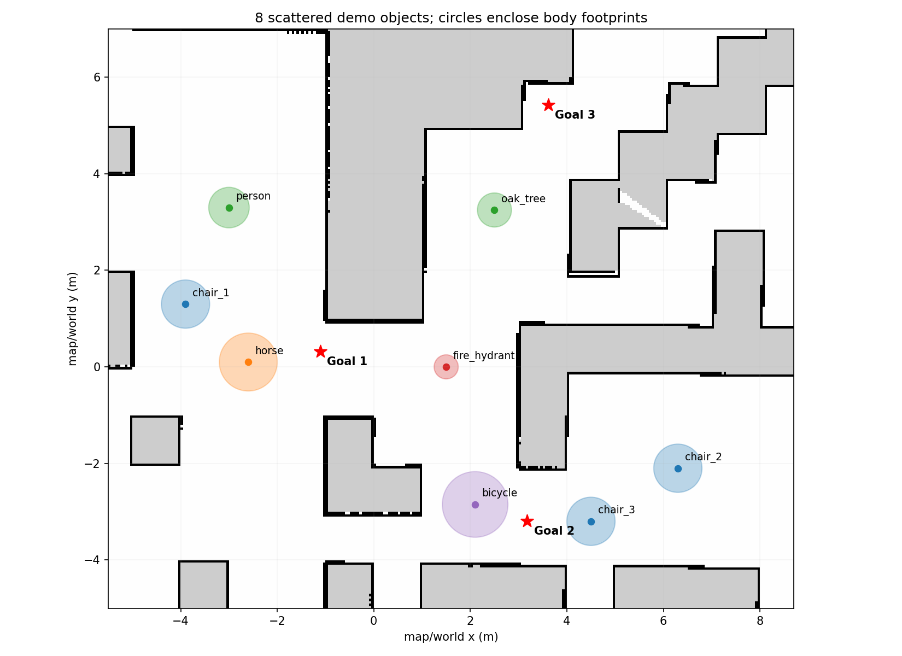
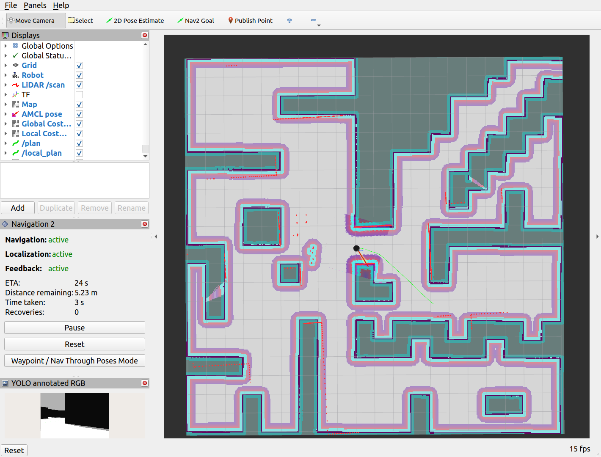
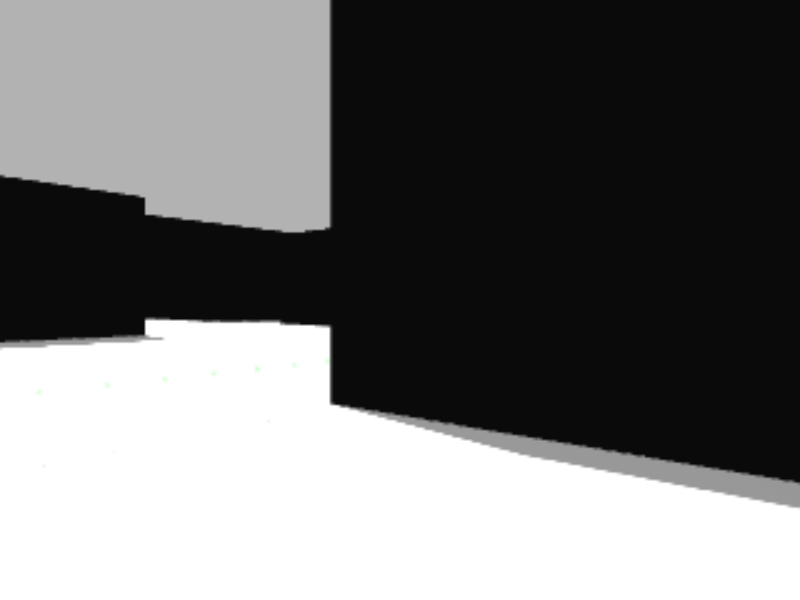
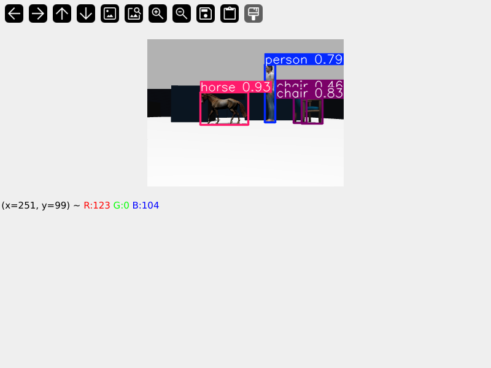
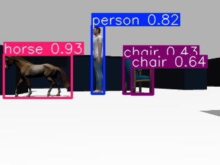
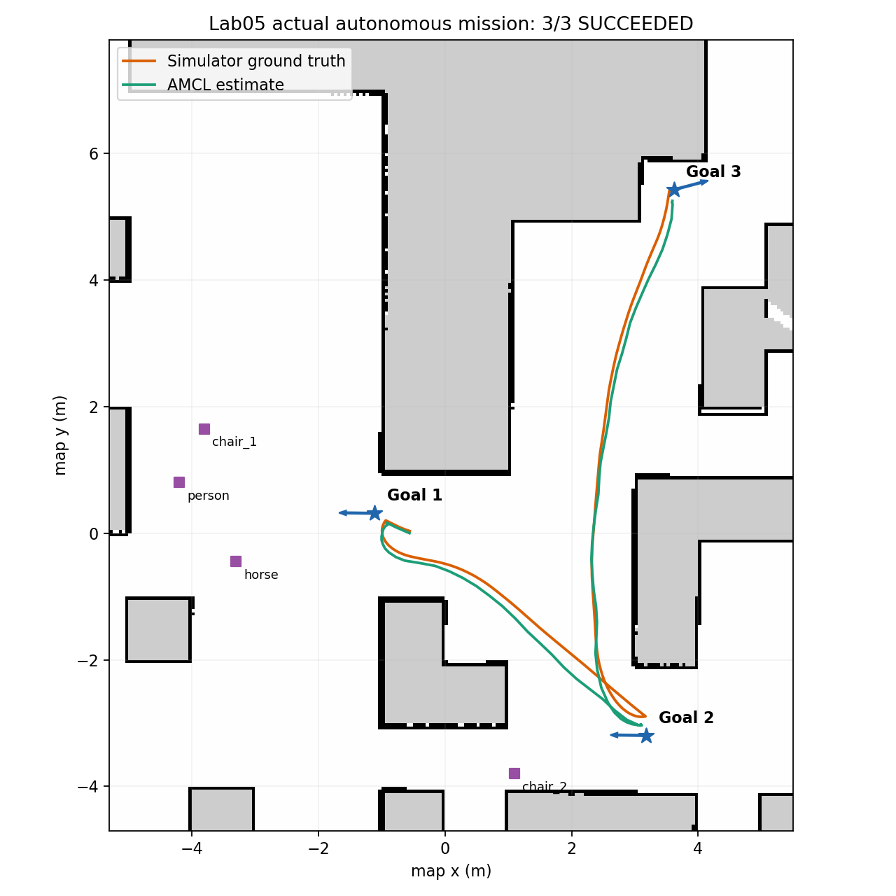

# Kiểm chứng Bài 05 — dữ liệu chạy thật

Ngày kiểm tra **15/10/2026** (Asia/Ho_Chi_Minh), workspace
`~/turtlebot4_lab_ws`, ROS_DOMAIN_ID=64, maze/standard, Ignition Fortress 6.18.0,
ROS 2 Humble. Không dùng teleop, click goal hoặc cập nhật initial pose trong
lượt mission dưới đây. Node tự gửi ba action liên tiếp. Dữ liệu ground truth
chỉ được observer subscribe để đối chiếu; Nav2 dùng AMCL/LiDAR/odometry.

## Cấu hình hiện tại và rà soát 20/10/2026

Cấu hình mới gồm **8 vật thể**: 1 người, 1 ngựa, 3 ghế, 1 xe đạp,
1 trụ cứu hỏa và 1 cây sồi. Balô/STOP cũ đã được retire. Tọa độ, scale,
collision box nằm trong `config/objects.yaml`; hình và số đo hiện tại:
[scene_layout.json](validation/scene_layout.json).

YOLO11s: confidence chung **0.30**, person **0.55**, potted plant **0.15**;
NMS IoU **0.45**; xác nhận **2 frame**, IoU ≥0.25, timeout **1.5 s**.
Person có bộ lọc hình học h≥35 pixel và 1.1≤h/w≤4.5. Bộ lọc nhằm giảm nhầm
thoáng qua, có thể giảm recall; chưa có benchmark đa góc/accuracy của bản mới.
Cây sồi không phải ground truth lớp COCO `potted plant` chỉ vì tên nhãn nằm trong filter.

Rà soát hiện tại:
- **20/20 pytest qua**, gồm cấu hình, bbox confirmation, scene geometry,
  ROS steady timer/shutdown; ROS tests dùng domain 67, không gửi goal.
- `colcon build --symlink-install --packages-select turtlebot4_lab05`: thành công.
- Hai launch `--show-args` và 5 executable: hợp lệ.
- 8 vật thể đạt validator map/unknown + box tường SDF + khoảng hở giữa từng cặp.
  Ngưỡng hở tường 0.35 m, giữa vật thể 0.60 m. Min map-body gap **0.385 m**,
  min actual-wall-body gap **0.420 m** (xe đạp).
- **Không chạy lại simulator/mission/inference trong lần rà soát này.** Ảnh và
  số liệu 3-goal/YOLO tự động bên dưới thuộc các phiên bản lịch sử 15/10/2026.
  Không gán số liệu đó cho YOLO11s/scene 8 vật thể.

[Video demo](https://drive.google.com/file/d/1L9oFTGC_8RS8bYuAewitxUT4dYWiAlEM/view) · [Báo cáo PDF](report/report.pdf). Báo cáo có ảnh trích video hiện có
của người thực hiện, kèm timestamp và phân biệt với bảng số liệu lịch sử.

## Lịch sử bố trí balô — sáu vật thể rải rác, đã chạy lại

Hướng dẫn quay theo thứ tự terminal và thời điểm Record: [VIDEO_DEMO.md](VIDEO_DEMO.md).
Bố trí mới giữ nguyên ảnh map và cả ba waypoint. Ghế cũ ở (1.1,-3.8) không đủ
khoảng hở phần thân với tường; đã chuyển sang phòng rộng phía đông. Thêm một
người gần đoạn tới Goal_3 và một balô gần Goal_2, tổng 2 người + 1 ngựa + 2 ghế
+ 1 balô. Lượt sáu vật thể này thay cho bố trí bốn vật thể ở các lượt
lịch sử phía dưới, và đã được thay tiếp bởi scene tám vật thể hiện tại.

Validator scene đối chiếu cả vòng tròn bao
footprint với map known-free/unknown, box tường SDF thật và khoảng cách các vật
thể. Yêu cầu hở tường >=0.35 m, giữa các footprint >=0.60 m. Khoảng hở tường
thật nhỏ nhất trong scene sáu vật thể cũ 0.494 m (balô); hai ghế hở 0.60 m và 1.40 m. Đây là kiểm
tra hình học bảo thủ, không suy ra bảo đảm an toàn mọi tình huống.

Lượt kiểm chứng mới: **3/3 SUCCEEDED**, mission_completed=true,
yolo_interrupted=false. UUID Goal_1 a349bd4177f34f948061a58ff0bd1410, Goal_2
a3e25217f24c42148486c6935927673c, Goal_3 dae38aef46844f72bc7491de7aa3dae4.
YOLO có 713 ảnh annotated, 713/713 header khớp ảnh vào, 615 inference khi robot
chuyển động; model thực ở cuda:0. Max confidence person=0.925, horse=0.953,
chair=0.895. Không ghi nhận bump/cliff/stall/wheel drop trong lượt chạy.

Balô Fuel CC0 v3 được thêm để đa dạng cảnh; model có lúc gán nhầm suitcase
(confidence tối đa 0.624), không tính đó là backpack nhận diện đúng. Cũng có
nhầm dog, không coi là model dog thật. Output giữ nguyên prediction pretrained,
không thay nhãn. Manifest có URL/version/hash/giấy phép asset mới.

Bằng chứng: [scattered_demo_summary.json](validation/scattered_demo_summary.json),
[scattered_mission_events.json](validation/scattered_mission_events.json),
[hai cửa sổ native khi Goal_3 RUNNING](validation/scattered_windows_during_navigation.json).
12/12 kiểm thử qua, gồm hồi quy ghế cũ dính tường và vật thể chồng nhau
([scene_tests.txt](validation/scene_tests.txt)). Spawn mới và thay scene đang tồn
tại bằng replace_existing:=true đều đã chạy; chỉ thay tên model lab05_ được
cấu hình, không sửa tường/nền/robot. Build cuối thành công.

## Lượt 2 — lịch sử trước khi sắp xếp lại, cửa sổ camera

Lượt chạy lại trên desktop ngày 15/10/2026 hoàn tất **3/3 goal SUCCEEDED**,
YOLO và RViz mở cùng lúc. Cửa sổ `TurtleBot 4 Lab05 - YOLO RGB` thực sự ở
map_state=2 (IsViewable), không chỉ publish topic. Ảnh native window được chụp
khi Nav2 RUNNING Goal_2; dữ liệu trong
[windows_during_navigation.json](validation/windows_during_navigation.json).

| Nội dung yêu cầu | Kết quả đã chạy |
|---|---|
| Load lại map tuần trước, localization trên RViz2 | Đúng bản sao map PGM, AMCL active, TF hợp lệ; scan khớp tường quanh robot; RViz hiển thị map/pose/scan/costmap |
| Code tự chạy ≥03 navigation goal liên tiếp | Goal_1 → Goal_2 → Goal_3 đều SUCCEEDED; không teleop/click goal trong mission |
| Cửa sổ camera YOLO chạy song song lúc robot đi | Native OpenCV preview + RViz Image; 555 ảnh annotated, 451 inference khi odom đang chuyển động; model ở cuda:0 |

UUID mới: Goal_1 `e31eed98b33d42c9bb9f672448cf2200`, Goal_2
`5f1207d020f64745bfa24a02c54f98b8`, Goal_3
`69714f9835aa4b21a0c5f6fc2b76d88f`. Kết thúc mission_completed, completed=3,
yolo_interrupted=false. Không ghi nhận bump/cliff/stall/wheel drop; robot đứng
lại cuối lượt. [gui_demo_summary.json](validation/gui_demo_summary.json) và
[gui_mission_events.json](validation/gui_mission_events.json) chứa số đo gốc.

Confidence tối đa person=0.832, horse=0.946, chair=0.910; có nhầm nhãn dog=0.677
(không tính là model dog thực). Có 554/555 header được observer đối chiếu với RGB
đã nhận trước callback; một ảnh chưa ghép được nguồn trong quan sát Best Effort,
không coi là bằng chứng header bị đổi. Node vẫn copy nguyên header; lượt baseline
đã đối chiếu 533/533. Chi tiết thời gian/inference ở
[gui_demo_metrics.json](validation/gui_demo_metrics.json).

Sửa launch dùng GroupAction để tham số rviz=false của launch con không ghi đè
lựa chọn mở RViz của bài 05. Launch YOLO/bringup mặc định bật cửa sổ, có
show_window:=false cho headless. Preview phóng lớn 800 px giữ tỷ lệ, không đổi
độ phân giải/header ảnh publish.

Camera khi thấy đủ ba nhóm (trước nhiệm vụ; không gán ảnh này là đang chuyển động):

## Lượt 1 — baseline headless và dữ liệu đối chiếu

| Goal | NavigateToPose UUID | Kết quả | Sai số vị trí AMCL gần lúc action kết thúc |
|---|---|---|---|
| Goal_1 | `458ca4bc94d243da8099abe6bf6aece9` | SUCCEEDED (4) | 0.246 m |
| Goal_2 | `3bc5b982b32f4590aeb9762862026fb5` | SUCCEEDED (4) | 0.174 m |
| Goal_3 | `3b94aceb424747c1aa8e8f00309c6094` | SUCCEEDED (4) | 0.178 m |

`mission_completed`, completed=3, yolo_interrupted=false. Từ gửi Goal_1 đến hết
thời gian dừng Goal_3: **162.34 giây thực / 81.801 giây mô phỏng**; RTF khoảng
0.50 khi Gazebo và YOLO cùng dùng GPU. Không suy ra tốc độ chạy trên robot thật.
Goal checker của cấu hình Nav2 cho phép sai số; SUCCEEDED không có nghĩa tọa độ
trùng tuyệt đối. Sai số ground truth tương ứng 0.211 / 0.302 / 0.073 m; observer
lấy mẫu cách thời điểm result không quá 0.15 giây. Số đầy đủ trong
[demo_metrics.json](validation/demo_metrics.json).

Observer nhận **2606 ảnh RGB**, **533 ảnh annotated**, **533/533 header khớp**
(stamp + frame), và **428 inference trong lúc odometry ghi nhận chuyển động**.
Tham số model thực sự ở `cuda:0`; GPU NVIDIA GeForce RTX 3060 Laptop 6144 MiB,
PyTorch 2.5.1+cu121, CUDA runtime 12.1. Median inference 116.13 ms, p95 156.55 ms;
tốc độ xử lý khoảng 3.1 ảnh/giây thực (có giới hạn rate, lấy ảnh mới nhất).
Không dùng FPS camera để nhận là FPS inference.

Confidence tối đa trong lượt chạy: **person 0.826, horse 0.942, chair 0.911**.
Đây là output pretrained theo góc nhìn mô phỏng, không phải đánh giá accuracy
trên dataset. Có detection `dog` 0.724 mặc dù không có model dog trong bốn vật
thể cuối: đó là nhầm nhãn, không tính thành một vật thể/nhóm đã kiểm chứng.
Asset Dog dạng đồ chơi trong lượt chẩn đoán nhận diện kém; đã gỡ trước demo và
thay bằng asset horse có texture/visual phù hợp hơn. Horse thuộc nhãn COCO được
model hỗ trợ và đáp ứng nhóm động vật.

Bốn asset trong lượt baseline cũ: một Standing person CC0, một Breyer Horse và hai Chair CC-BY-4.0.
URL, owner, version và SHA256 trong [resources_manifest.json](config/resources_manifest.json);
pose/scale/collision box trong [objects.yaml](config/objects.yaml). Các ảnh/mesh
lớn tải từ Fuel, không đưa vào repository. Không thay tường/nền maze.

Không ghi nhận bump/cliff/stall/wheel drop trong `/hazard_detection` trong lượt
chạy (đối chiếu mọi callback trong [hazard_event_audit.json](validation/hazard_event_audit.json)); có hazard type 0 (backup limit), không coi là va chạm. Robot dừng cuối lượt:
linear_x khoảng 2.54e-15 m/s, angular_z khoảng -1.61e-15 rad/s. Đây là quan sát
của **một lượt mô phỏng**, không phải chứng minh không va chạm trong mọi tình
huống hoặc kiểm định an toàn cho robot vật lý.

Map PGM giống hệt bản gốc bài 04, SHA256
`3703cf26d1c6d7b7e6e65b40dc2d4e54419bf533e4fd401e12f88c8037153d37`.
YAML bản sao dùng free_thresh=0.196 để pixel gray205 giữ unknown; map gốc không
sửa. Waypoint có provenance từ lượt bài 04 SUCCEEDED ([snapshot phép đo](validation/prior_waypoint_measurements.json)), kiểm tra map hash và
known-free disk trước khi gửi action. Goal_3 dùng **pose AMCL cuối đã đo** của
lượt bài 04 thay vì endpoint cũ sát vùng unknown; không phỏng đoán tọa độ.

## Các kiểm tra static/build/runtime của những lượt lịch sử

| Loại | Kiểm tra | Kết quả/bằng chứng |
|---|---|---|
| Static/unit | YAML chưa validated, sai hash, NaN, unknown/obstacle/map quay, yaw→quaternion | 6 ca qua, `test/test_configuration.py` |
| Static/unit + ROS timer | Ctrl+C khi chưa ACK goal, không ghi đè interrupt, timeout khi ROS clock=0 | 3 ca qua (tổng 9/9); không gửi goal, chạy domain riêng |
| Build | colcon, executable, share launch/config/maps/docs | `validation/build_checks.txt`, build thành công, executable/share/launch argument đã kiểm tra |
| Runtime readiness | Map server/AMCL/Nav2 active, `/clock`, `/scan`, TF map→odom→base_link, covariance | readiness_passed trong `validation/mission_events.json` |
| Runtime GPU/camera | Cùng môi trường Python import ROS/OpenCV/torch/YOLO; tensor + model CUDA | `validation/python_gpu.json`, `validation/demo_summary.json` |
| Runtime navigation | Ba action thật SUCCEEDED liên tiếp; đồng thời YOLO | `validation/mission_events.json`, `demo_summary.json`, ảnh và quỹ đạo trên |
| Runtime timeout/retry | goal_timeout=0.4 s, retries=1, retry_delay=0.5 s | Hai goal accepted rồi CANCELED (5), cuối mission_failed; không hoàn thành giả; `validation/navigation_diagnostics.json` |
| Runtime Ctrl+C | SIGINT sau khi Nav2 chấp nhận goal | Action CANCELED (5), exit=130, `validation/interrupt_check.json` |
| Runtime guard | localization_confirmed=false | Không gửi goal; readiness timeout; `navigation_diagnostics.json` |
| Runtime mất camera | Domain 66, CPU chọn tường minh, topic không có publisher | waiting_camera, frames=0, exit=0 sau SIGINT; `validation/missing_camera_check.json` |

Các lượt timeout/Ctrl+C là chẩn đoán riêng trước demo chính, không cộng vào ba
SUCCEEDED. Log/raw trace cục bộ ở `evidence/lab05/`, không commit; snapshot JSON
nhỏ đã chọn ở `validation/`. `record_demo.py` có thể thu lại bằng chứng khi quay.
Bản cuối dùng steady-clock timer cho timeout/heartbeat, để pause simulation không
làm treo timeout. Không đổi timestamp ảnh/pose sang wall clock.

## Đối chiếu yêu cầu bài

| Yêu cầu | Chức năng/bằng chứng |
|---|---|
| Đúng simulator/world/map cũ | Reuse Lab04 launch, maze/standard/Fortress; maps/PROVENANCE.md, map hash |
| AMCL/Nav2/sim time, initial pose | bringup.launch.py, initialize_pose.py (trước mission), readiness gate và TF |
| ≥3 waypoint thật, không chạy sample | waypoints.yaml validated + source UUID + hash + known-free margin |
| Publish Point và yaw | capture_waypoints.py; README giải thích PointStamped không có yaw, radian/quaternion |
| Tự gửi tuần tự, feedback, dwell | sequential_navigation.py, ba UUID SUCCEEDED, dwell 8 giây |
| Timeout/retry/failure/Ctrl+C | Chẩn đoán Nav2 thật + regression tests; chỉ status=4 là thành công |
| YOLO RGB thật/GPU/header/QoS | latest-frame worker, Best Effort, cv_bridge, CUDA model device, 533 header khớp |
| Bbox/class/confidence/headless/log/rate | Annotated topic + ảnh thật; RViz; OpenCV tùy chọn; log_interval/inference_rate |
| Người/động vật/đồ vật | Hiện tại 8 model static; geometry trong scene_layout.json; runtime sáu vật thể cũ trong scattered_demo_summary.json |
| YOLO chạy khi robot chuyển động | 428 inference có robot_moving=true; YOLO không phát cmd_vel/goal |
| Không va chạm trong lượt demo | Không thấy bump/cliff/stall/wheel drop; quỹ đạo/pose/hazard quan sát được |
| Dependency/build/install/README | package.xml/setup.py, requirements/lock, script setup/download, README tiếng Việt |
| Git sạch artefact lớn, assignments_2 | .gitignore, manifest download; SHA và remote được đối chiếu sau push |

## Giới hạn và phần người dùng bổ sung

- Video người thực hiện đã cung cấp: [Video demo](https://drive.google.com/file/d/1L9oFTGC_8RS8bYuAewitxUT4dYWiAlEM/view); không tự suy ra metrics mới từ bảng số liệu cũ.
- Đã mở cửa sổ OpenCV và RViz trên desktop hiện tại (`DISPLAY=:1`), chụp native
  window khi Nav2 đang RUNNING; chưa kiểm tra trên mọi display/driver khác.
- CPU startup/mất camera đã kiểm tra; chưa ép CUDA lỗi/OOM để kiểm thử nhánh
  fallback inference CPU, và chưa tiêm ảnh hỏng/model hỏng. Có xử lý trong code,
  không ghi là đã runtime-test các nhánh chưa chạy.
- Kiểm thử bound khi thiếu ACK là regression mô phỏng state của client, không
  phải cắt mạng Nav2 thật. Khi server không phản hồi cancel, node dừng báo lỗi;
  không thể bảo đảm server đã hủy khi mất liên lạc. Không gửi retry trong trạng thái đó.
- GitHub hiển thị Public khi kiểm tra trang repository; không thay đổi visibility
  và không upload video. SHA nhánh remote được kiểm tra sau push.
- Chưa chạy trên robot vật lý. Không dùng tọa độ/world alignment này trên map khác.
